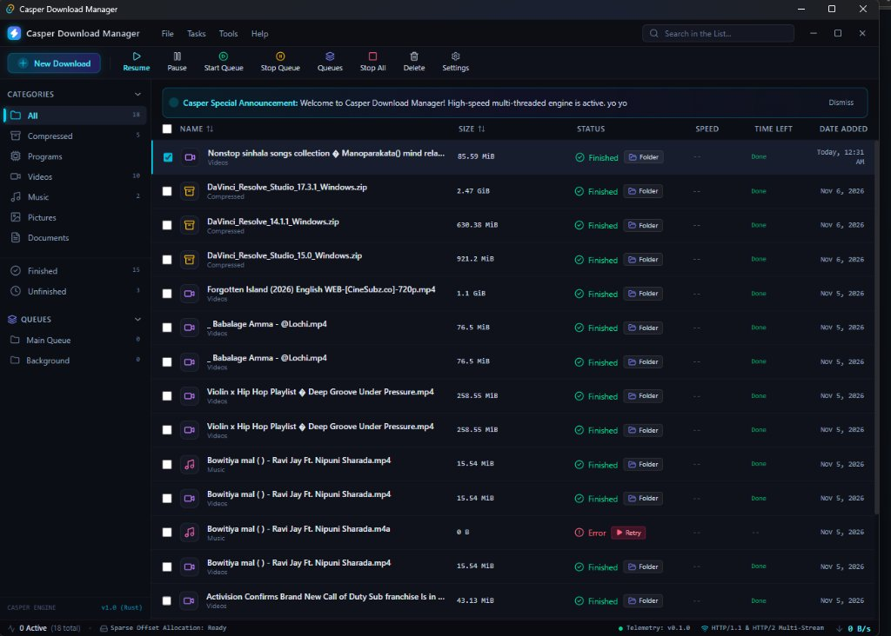
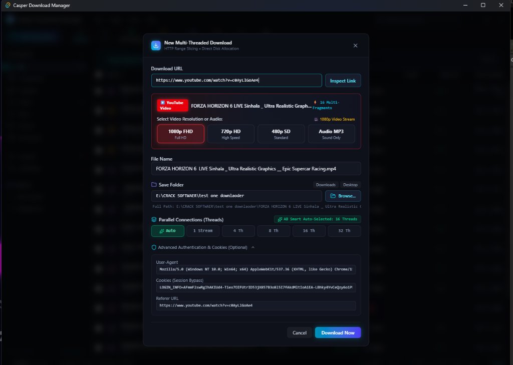
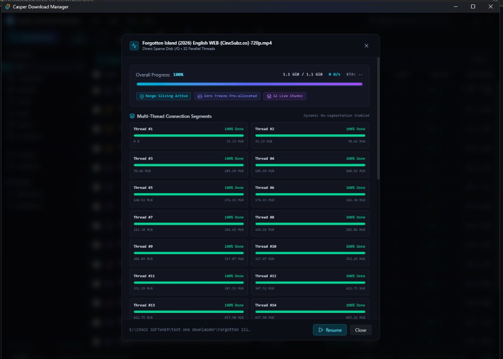
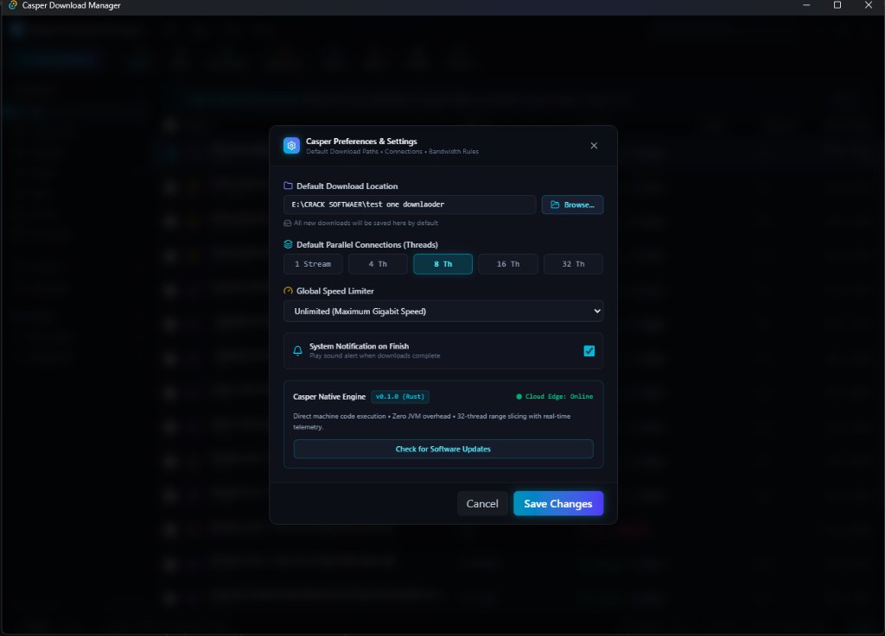

# ⚡ Casper Download Manager

### **Engineered & Developed by [SriX.lk](https://srix.lk)**

**The Next-Generation High-Speed Multi-Threaded Download Manager for Windows**

[-0078D4?style=for-the-badge&logo=windows)](https://github.com/HeroxMusty/CASPER-DOWNLOADER/releases/latest)

 

### 🔽 [Download Official Installer (Free)](https://github.com/HeroxMusty/CASPER-DOWNLOADER/releases/latest)

 

---

## 🔥 Casper vs IDM vs AB Download Manager

Why choose **Casper Download Manager** over conventional download managers?

| Feature / Capability | ⚡ Casper (SriX.lk) | 🐢 IDM (Internet Download Manager) | 📦 AB Download Manager |
|---|:---:|:---:|:---:|
| **Pricing & License** | **100% Free Forever** ✅ | **$24.95 / year** (or risky cracks) ❌ | Free & Open Source ✅ |
| **Cracks / Keygens Required?** | **Never Needed (Zero Security Risk)** ✅ | "Fake Serial Key" popups & malware risk ❌ | Not needed ✅ |
| **Download Acceleration** | **Up to 32 Parallel Channels (Zero-Freeze Disk I/O)** 🚀 | 32 Threads (High CPU & Disk Freezes) ⚠️ | Limited throughput ⚠️ |
| **1080p FHD & 4K Video + Audio** | **Built-in High-Definition Remuxing Engine** ✅ | Often fails on YouTube cipher updates ⚠️ | Limited video resolution ⚠️ |
| **System Memory (RAM Usage)** | **~25 MB (Ultra-Lightweight Native)** ✅ | ~45 MB (Legacy Win32 architecture) ⚠️ | ~250 MB+ (Heavy Java Runtime overhead) ❌ |
| **Installer Size** | **~1.89 MB (Micro-Footprint)** ✅ | ~15 MB ⚠️ | ~85 MB+ (Bundled JVM) ❌ |
| **User Interface (UI)** | **Modern Dark Cyberpunk / Gaming Aesthetic** 💎 | 1998 Windows 98 Retro Interface ❌ | Standard generic UI ⚠️ |
| **Adware & Nag Screens** | **Zero Ads • Zero Annoying Popups** ✅ | Aggressive popups demanding license purchase ❌ | Minimal popups ✅ |
| **Instant Auto-Resume** | **Seamless Byte-Level Recovery** ✅ | Standard resume ⚠️ | Standard resume ⚠️ |
| **Engineering & Ownership** | **[SriX.lk](https://srix.lk) (Official Release)** 🇱🇰 | Tonec Inc. (USA) | Generic Community Project |

---

## 📸 User Interface & Feature Showcase

### 🎬 1080p Full HD Video & Audio Downloader
Effortlessly download videos in 1080p FHD, 4K, or pure MP3 audio from YouTube, Facebook, and other major platforms.  
 

  

### ⚡ 32-Thread Real-Time Range Slicing Engine
Visual breakdown of concurrent download streams with real-time speed tracking and dynamic allocation.  
 

  

### ⚙️ Advanced Preferences & Control Center
Customize default save paths, connection thread limits, notifications, and speed throttling.  
 

---

## ✨ Key Features

- **⚡ Multi-Threaded Acceleration:** Divides downloads into up to 32 parallel streams to saturate your internet connection up to 10x faster.
- **🎬 1080p & 4K Video Downloader:** Direct high-definition stream capture with synchronized audio merging.
- **🔄 Smart Auto-Resume:** Interrupted downloads automatically resume exactly where they left off without data loss.
- **🌐 Browser Integration:** Compatible with Chrome, Edge, and Chromium-based browsers for one-click download capture.
- **🔔 Live System Announcements:** Real-time updates and essential security notices delivered directly inside the client.
- **🌙 Modern Dark Cyberpunk UI:** Designed for modern displays with fluid animations, intuitive layouts, and low eye strain.
- **🛡️ 100% Virus & Malware Free:** Clean installer with zero bundled adware, bloatware, or hidden background services.

---

## 📥 Installation Guide

### Step 1: Download the Installer
Download the latest official setup binary:  
👉 **[Casper-Download-Manager-Setup.exe](https://github.com/HeroxMusty/CASPER-DOWNLOADER/releases/latest)**

### Step 2: Run Setup
1. Double-click `Casper-Download-Manager-Setup.exe`.
2. Accept the **Terms of Service & Rules** on the setup wizard.
3. Choose your installation directory and click **Install**.

> 💡 **Windows SmartScreen Note:**  
> If Windows displays an "Unknown Publisher" prompt for this newly released software, click **"More info"** and then select **"Run anyway"**.

### Step 3: Launch Casper 🎉
Launch **Casper Download Manager** from your desktop or start menu shortcut to enjoy blazing-fast download speeds!

---

## 📜 Terms of Service & Usage Rules

1. **Intellectual Property:** Casper Download Manager and all associated compiled binaries are the exclusive property of **SriX.lk**.
2. **Reverse Engineering Prohibition:** Decompilation, disassembly, binary modification, or unauthorized redistribution of this software is strictly prohibited.
3. **Responsible Usage:** Users are solely responsible for ensuring compliance with copyright and digital rights laws when downloading third-party media.

---

## 🏢 Developer Information

- **Engineering & Maintenance:** [SriX.lk](https://srix.lk)
- **Official Website:** [https://srix.lk](https://srix.lk)
- **Product Inquiries & Feedback:** [GitHub Issues](https://github.com/HeroxMusty/CASPER-DOWNLOADER/issues)

---

**Developed with pride by [SriX.lk](https://srix.lk)**

[⬇️ Download Casper](https://github.com/HeroxMusty/CASPER-DOWNLOADER/releases/latest) · [🌐 Visit SriX.lk](https://srix.lk) · [🐛 Issues & Feedback](https://github.com/HeroxMusty/CASPER-DOWNLOADER/issues)

